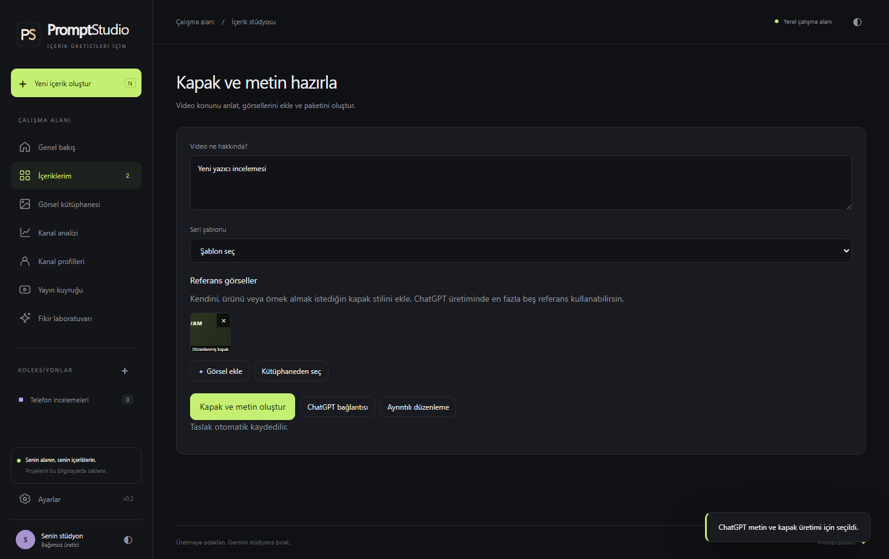

# PromptStudio

**[Windows için PromptStudio 0.7.2’yi indir (.exe)](https://github.com/emrhn034/PromptStudio/releases/download/v0.7.2/PromptStudio.Setup.0.7.2.exe)** · [En yeni sürüm](https://github.com/emrhn034/PromptStudio/releases/latest)

**YouTube kapağını, video başlığını, açıklamasını ve etiketlerini tek yerden hazırla.** PromptStudio, içerik üreticileri için Türkçe bir Windows uygulamasıdır. Bir video konusu yazabilir, kendi görsellerini referans olarak ekleyebilir ve beğendiğin kapak stilini sonraki videolarında tekrar kullanabilirsin.

[Ayrıntılı kullanım kılavuzu](PromptStudio/README_TR.md)

## Bir videodan örnek

Diyelim ki **“Karlı bir dağ evinde 24 saat geçirdim”** videosunu hazırlıyorsun. Konuyu bir cümleyle yaz. Kapak için kendi portreni, dağ evinin fotoğrafını ve sırt çantanın görselini ekle. İstersen her birine “beni ön plana al”, “evi arka planda göster” gibi bir not düş.

Aynı projeden YouTube Studio’ya taşıyabileceğin bir paket çıkar:

| Hazırlanan | Örnek sonuç |
| --- | --- |
| **Kapak** | Önde sen ve sırt çantan, arkada karlı dağ evi. Görseli PNG olarak kaydedebilirsin. |
| **Video başlığı** | Karlı Dağ Evinde 24 Saat: Gece Nasıl Geçti? |
| **Açıklama** | Bu videoda karlı bir dağ evinde geçirdiğim 24 saati, yanıma aldıklarımı ve gecenin nasıl geçtiğini paylaşıyorum. |
| **Etiketler** | karlı dağ evi, kış vlogu, dağda 24 saat, doğa vlogu |

*Görsel ve metinler, iş akışını göstermek için hazırlanmış örneklerdir.*

## Windows’ta ilk projeni hazırla

1. **[Kurulum paketini indir](https://github.com/emrhn034/PromptStudio/releases/latest).** GitHub Releases sayfasında **Assets** bölümündeki `PromptStudio.Setup…exe` dosyasını aç.
2. **ChatGPT hesabını bağla.** PromptStudio’daki **ChatGPT ile giriş yap** seçeneği [Codex CLI](https://developers.openai.com/codex/cli) kullanır. Ayrıntılı stüdyoda desteklenen sağlayıcılara kendi API anahtarınla da bağlanabilirsin.
3. **Kapak ve metin hazırla.** Konuyu yaz, istersen görsel ekle ve **Kapak ve metin oluştur** düğmesine bas. Sonucu kontrol et, metinleri kopyala ve kapağı kaydet. Kapak yazısını veya logoyu istersen editörde düzenle.

*Gerçek uygulama ekranı: video konusunu yaz, referanslarını seç ve üretimi başlat.*

## Bir sonraki bölümde baştan başlama

Örneğin **Kış Vlogları** adında bir seri şablonu oluştur. Referanslarını kullanım notlarıyla kütüphaneye kaydet; yeni bölümde şablonu seçip logonu, görsellerini ve kapak stilini yeniden kullan. Konuyu değiştirerek yeni bir paket hazırlayabilir, yarım kalan projeyi daha sonra açıp devam edebilirsin.

**YouTube hesabı gerekli mi?** Kapak ve metin hazırlamak için gerekmez. Kanalını bağlarsan performans verilerini inceleyebilir ve analizden yeni bir proje taslağı açabilirsin.

**Uygulama ücretli mi?** PromptStudio ücretsizdir. Yapay zekâ kullanımında, seçtiğin hesabın veya API sağlayıcısının ücret ve kullanım limitleri geçerlidir.

## Katkıda bulun

- Bir hata bulduysan veya özellik önermek istiyorsan [Issues](https://github.com/emrhn034/PromptStudio/issues) bölümünde bir konu aç.
- Kod katkısı için depoyu kendi hesabına **fork** et, değişikliklerini kendi kopyanda bir dala gönder ve bu deponun `main` dalına bir [Pull Request (PR)](https://github.com/emrhn034/PromptStudio/pulls) aç. Neyi değiştirdiğini ve nasıl denediğini yaz.
- Proje sahibi PR’ı inceler, gerekirse düzeltme ister ve uygun bulursa birleştirir. Kullanıcılara güncelleme sunmak için ayrıca yeni bir Windows sürümü yayımlanır.

## Geliştirme

Uygulama kaynakları `PromptStudio/` klasöründedir.

- Çalıştır: `PromptStudio/BASLAT.bat`
- Geliştirme: `cd PromptStudio`, `npm ci`, `node node_modules/electron/install.js`, `npm start`
- Kontrol: `npm run check`, `npm test`, `npm run test:desktop`
- Paketleme: `npm run dist -- --publish never`
- [YouTube kurulumu, veri saklama ve sürüm dağıtımı](PromptStudio/README_TR.md)

`v*.*.*` etiketi gönderildiğinde `.github/workflows/release.yml` Windows kurulum paketini oluşturup GitHub Releases’ta yayımlar. Etiket `PromptStudio/package.json` sürümüyle eşleşmelidir. Uygulama yeni sürümleri bu deponun Release sayfasından kontrol eder.
