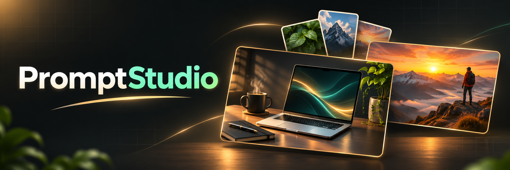
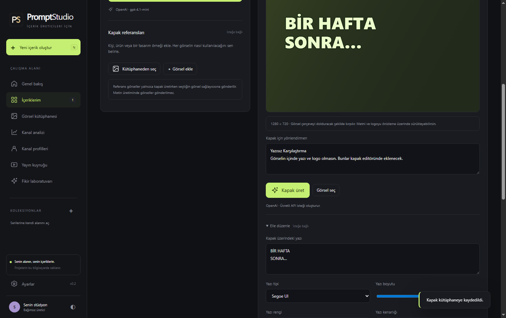

# PromptStudio

**YouTube kapağını, video başlığını, açıklamasını ve etiketlerini tek yerden hazırla.** PromptStudio, içerik üreticileri için Türkçe bir Windows uygulamasıdır. Bir video konusu yazabilir, kendi görsellerini referans olarak ekleyebilir ve beğendiğin kapak stilini sonraki videolarında tekrar kullanabilirsin.

**[Windows için PromptStudio’yu indir](https://github.com/emrhn034/PromptStudio/releases/latest)** · [Ayrıntılı kullanım kılavuzu](PromptStudio/README_TR.md)

## İlk projen

1. PromptStudio’yu kur ve **ChatGPT ile giriş yap** seçeneğini kullan. Bu bağlantı için bilgisayarında [Codex CLI](https://developers.openai.com/codex/cli) kurulu olmalı. İstersen ayarlardan API anahtarıyla da bağlanabilirsin.
2. **Kapak ve metin hazırla** ekranında video konunu yaz. İstersen bir yüz, ürün veya stil örneği ekle ve her görselin nasıl kullanılacağını belirt.
3. Kapak, başlık, açıklama ve etiketleri oluştur. Metinleri kopyala, kapağı PNG olarak kaydet. İstersen kapağın yazısını ve logosunu editörde düzenle.

*İllüstrasyon: referans görsellerinin bir kapak fikrinde nasıl birleşebileceğine örnek.*

## Serinin görünümünü tekrar kullan

Kendi koleksiyonlarını oluştur, görselleri kullanım notlarıyla kütüphaneye kaydet ve seri şablonuyla aynı referansları, logoyu ve kapak stilini yeni projeye taşı. Taslakların bilgisayarında kalır; projeni açıp kaldığın adımdan devam edebilirsin.

*PromptStudio’dan gerçek ekran görüntüsü: referans ekleme, kapak üretme ve elle düzenleme.*

Kapak ve metin hazırlamak için YouTube hesabını bağlaman gerekmez. Kanalını isteğe bağlı bağlayarak performans verilerini inceleyebilir ve analizden yeni bir proje taslağı açabilirsin. Uygulama ücretsizdir; yapay zekâ kullanımı, seçtiğin hesabın veya API sağlayıcısının ücret ve limitlerine tabidir.

## Geliştirme

Uygulama kaynakları `PromptStudio/` klasöründedir.

- Çalıştır: `PromptStudio/BASLAT.bat`
- Geliştirme: `cd PromptStudio`, `npm ci`, `node node_modules/electron/install.js`, `npm start`
- Kontrol: `npm run check`, `npm test`, `npm run test:desktop`
- Paketleme: `npm run dist -- --publish never`
- [YouTube kurulumu, veri saklama ve sürüm dağıtımı](PromptStudio/README_TR.md)

`v*.*.*` etiketi gönderildiğinde `.github/workflows/release.yml` Windows kurulum paketini oluşturup GitHub Releases’ta yayımlar. Etiket `PromptStudio/package.json` sürümüyle eşleşmelidir. Uygulama yeni sürümleri bu deponun Release sayfasından kontrol eder.
